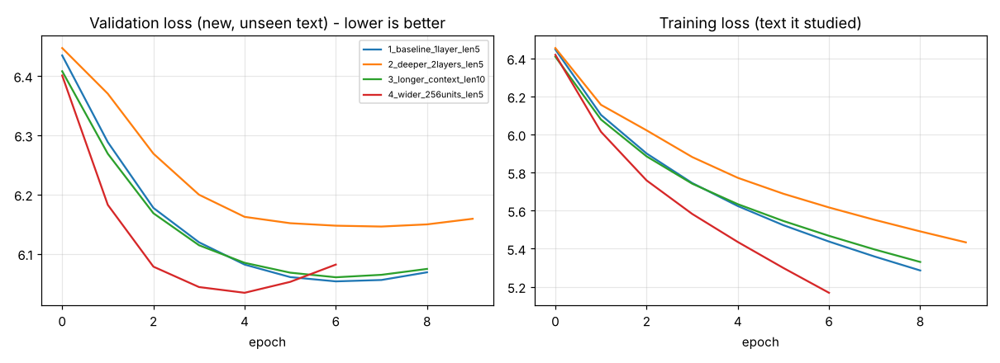

# Teaching a Computer to Write Like Shakespeare (LSTM Text Generator)

**Dataset:** Tiny Shakespeare (~1.1 MB, ~200,000 words)
https://raw.githubusercontent.com/karpathy/char-rnn/master/data/tinyshakespeare/input.txt
(Download it and save as `shakespeare.txt` next to the script. The full works are also at https://www.gutenberg.org/ebooks/100.)

**Run it:**
```
pip install tensorflow numpy
python lstm_text_generator.py --tag baseline --seq_len 5 --layers 1 --units 128
```

---

## The story, explained like you are in 5th standard

### What are we doing?
Imagine a game: I show you 5 words from a book, and you must guess the **6th word**.

> "to be or not to ___"  → you guess "be"!

If you play this game **200,000 times** with Shakespeare's book, you get quite good at guessing. Our computer plays exactly this game. Once it is good at guessing the next word, we can make it **write**: guess one word, add it, guess again, add it, again and again. That is "text generation".

### Step 1 - Clean the book (preprocessing)
- Make every letter **small** (`Romeo` → `romeo`), so the computer doesn't think `The` and `the` are different words.
- Remove **punctuation** (commas, dots, `!`), like erasing decorations.
- Cut the book into **words**.

### Step 2 - Give every word a number (tokenizing)
Computers don't understand words, only numbers. So we make a dictionary: `the = 1`, `and = 2`, `lord = 37`...
We keep the **5,000 most common words**. Rare words are all called `<unk>` (unknown), like calling every unfamiliar name "that kid".

### Step 3 - Make practice questions (input → output pairs)
We slide a window across the book:

| Question (5 words) | Answer (next word) |
|---|---|
| first citizen before we proceed | any |
| citizen before we proceed any | further |

That gives about **200,000 practice questions**, each with its answer.

### Step 4 - The brain (the model)
Three parts, like a team:
1. **Embedding layer = the word-meaning map.** Each word number becomes a list of 100 numbers, a "personality card". Words used in similar ways (`king`, `duke`) get similar cards.
2. **LSTM layer = the memory.** A normal brain forgets the start of a sentence by the end. An LSTM (Long Short-Term Memory) has little **gates** like doors: one decides *what to remember*, one decides *what to forget*, one decides *what to say next*. So it can remember "romeo" while reading the rest.
3. **Dense + softmax layer = the guesser.** It gives a **score for each of the 5,000 words** that adds up to 100%. For example: "be" 30%, "bed" 1%... The highest are the best guesses.

We also add **Dropout**: during practice we randomly switch off 20% of the brain. It's like studying with a few pages missing, so you learn properly instead of memorizing.

### Step 5 - Training (practice and exams)
- **90% of the questions** are for practice (training set). **10% are kept hidden** like a surprise exam (validation set).
- The computer guesses, sees the right answer, and fixes its mistakes. Loss = "how wrong it is" (smaller is better).
- **Early stopping**: if the exam score stops improving, we stop, because the student has begun memorizing instead of learning. The **checkpoint** saves the best version.

### Step 6 - Writing (text generation)
Give a **seed** like `to be or not to be`. The model gives the scores for the next word; we pick one using dice that favor high-score words, add it, and repeat 40 times.
**Temperature** is a "bravery knob":
- **0.6** = careful, picks safe words (more sensible, but repeats `the`, `my lord`)
- **1.0** = adventurous, picks surprising words (more creative, but more nonsense)

---

## Results

| Model | What's different | Parameters | Exam accuracy | Perplexity* | Training time |
|---|---|---|---|---|---|
| 1. Baseline | 1 LSTM layer, 128 cells, looks at 5 words | 1.26 M | 9.7% | 426 | 5.9 min |
| 2. Deeper | **2** LSTM layers | 1.39 M | 9.3% | 467 | 10.5 min |
| 3. Longer memory | looks at **10** words | 1.26 M | 9.8% | 428 | 9.1 min |
| 4. Wider | **256** cells | 2.15 M | 9.8% | **417** | 8.7 min |

\*Perplexity = "how many words the model is confused between on average". Lower is better. A random guesser would have ~5,000.



### Sample outputs (Baseline model, temperature 0.6)

- **Seed:** `first citizen before we proceed` →
  *first citizen before we proceed to swear that is the duke of york this good and mighty grace and to the world you will not this is a much by his blood of his love my lord and last most foot to the present his*
- **Seed:** `to be or not to be` →
  *to be or not to be an other in the world i am not been a man for this he may be not not the king and by the best camillo i shall be a more of the flight that thou canst we have heard a*
- **Seed:** `my lord the king` →
  *my lord the king to thee but my lord would you be the crown of the crown and have the business of our heart and the market sword and this murderer speak that i have heard thy words to my friend death why then*

(Many more, for all four models and both temperatures, are in `generated_text_samples.txt`.)

### What did we learn? (the bonus experiments)
1. **The writing sounds like Shakespeare, but doesn't make full sense.** It learned the *flavor*: "my lord", "thou canst", "duke of york", "heard thy words", and it picks names of real characters (camillo, henry bolingbroke). Short phrases are often fine; whole sentences wander off. That is normal for a small model that only sees 5 words.
2. **Bigger/deeper did NOT help much here.** All four models scored almost the same (~9-10% exam accuracy). The 2-layer model was actually a bit *worse* and twice as slow. With only ~200k words of data, a bigger brain just has more room to memorize.
3. **Overfitting is visible in the chart.** The *training* loss keeps going down (about 5.3 at the end) while the *exam* loss flattens out around 6.0-6.1 and stops improving after epochs 5-8, depending on the model. That gap means it is partly memorizing the book. That's why early stopping matters.
4. **Looking at 10 words instead of 5** gave no big gain, because word-by-word the next word depends mostly on the last 2-3 words, and the model has little data to learn long-range links.
5. **Temperature changes the style more than the architecture does.** 0.6 = calmer and repeats more, 1.0 = wilder and more random.

### How we could make it better
- Train on **characters** instead of words (no unknown-word problem, learns spelling too), or
- Use **much more text** (all of Gutenberg), or
- Use pre-trained word vectors (GloVe) or a **Transformer** model.

### Honest notes
- Accuracy of ~10% sounds low, but guessing the exact next word out of 5,000 is very hard (many words fit), so even humans would score low. Perplexity ~420 (vs 5,000 for random) shows it really learned.
- I trained on a 2-CPU machine for at most 12 epochs per model, with one run per setting, so small differences between models (like 417 vs 426) are within noise.
